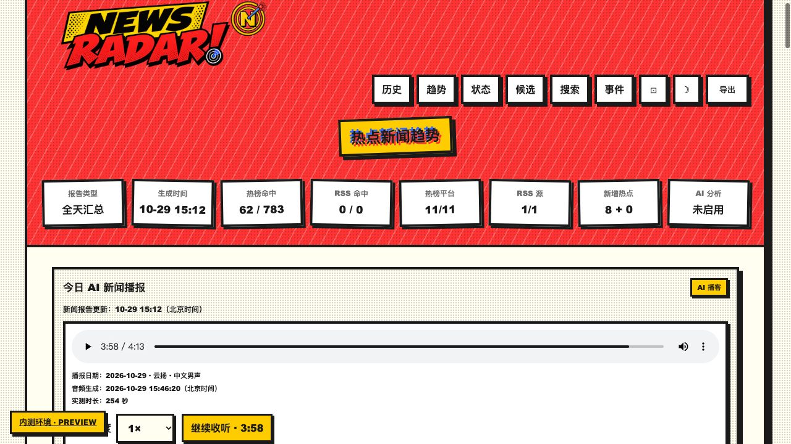
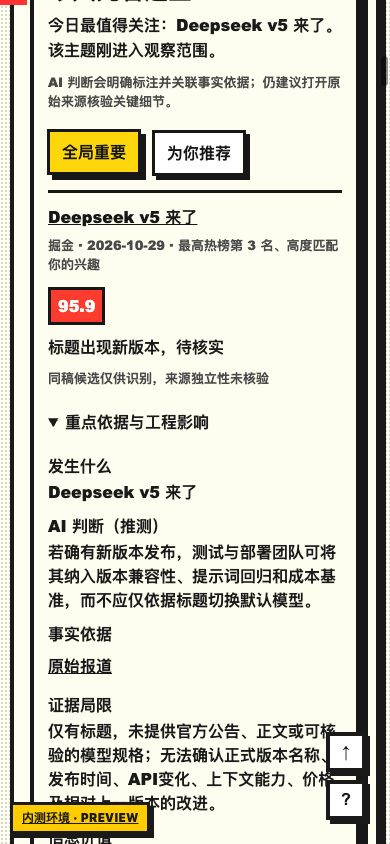

# P1 开发与自测证据 · 2026-10-29

## 范围与隔离

完成待办 07～14、19～20；15～18 为前批完成。本轮只发布内测，未更新正式采集工作目录、正式站点或历史数据库。开工快照 `.deploy/snapshots/pre-p1-20261029/source.tar`，基线 `8ce7999`。回退应先解包到临时目录审阅，再发布旧源码；不要直接覆盖含凭据/运行数据的目录。

## 自动验证

- Python unittest discover：148 项通过，包含真实生成器输出→网页/飞书/播客的契约测试。
- Node：28 项通过，覆盖进度/倍速、无自动播放、旧标签页写入竞争、章节跳转与推荐列表。
- JavaScript 语法检查、git diff --check 通过。
- 原始执行日志保存在本地 `.deploy/p1-python-tests.log`、`.deploy/p1-node-tests.log`，未提交运行密钥。
- 修复联调发现的问题：事实材料含 None 摘要/相对报告路径导致播客校验失败；稳定缓存误含抓取时间导致重复合成；旧内测试播可能覆盖未来日期；后台标签页可能写回旧进度；抓取 DNS/重定向/慢响应需要统一预算与公网 IP 固定连接。均有回归用例。

## 真实模型验证（用户授权）

24 条已采集的公开标题、现有兴趣说明与标签发送到现有 MiniMax-M2.5 服务；未发送数据库或认证秘密。标注由 Codex 编辑，未由用户逐条裁决，新闻真实性也未在本实验核实。

| 提示词 | 误收 | 漏收 | 入选正例标签正确数 |
|---|---:|---:|---:|
| 旧提示词 | 0 | 0 | 11/12 |
| 新提示词初版 | 0 | 0 | 10/12 |
| 边界调整中间版 | 0 | 1 | 11/11（漏选一条） |
| 最终版 | 0 | 0 | 12/12 |

初版把浏览器 AI 应用与攻防评估错归模型进展；中间版又因应用排除规则作用域过宽漏选。最终收紧标签边界、明确各分类排除条件的作用域。此数据集被用于调优，**不是独立测试集，不能把 100% 宣称为真实流量准确率**。可审计指标见 `P1_model_metrics_20261029.json`；输入见 `tests/fixtures/news_quality_real.jsonl`。持续人工复评仍未勾选完成。

另对当天 8 条重点候选评分，保留 7 条、排除 1 条；验证后的分析供网页、飞书预览及播客使用。飞书仅渲染校验，本轮未向正式新闻群发送测试分析。

## 一手材料与来源独立性

最多 5 条重点，12 次请求，20 秒总预算，缓存、robots、重定向校验、公网 IP 校验和固定 TLS 连接；失败保留原始来源并披露未补充成功。今日候选没有找到符合关联要求的官方材料，数量为 0，没有用官网首页替代。另用 vLLM 官方 serving 文档验证成功抓取路径（2 次请求），不冒充当天新闻的额外证据。

同标题/同链接只是转载候选；跨域名不等于独立信源。版本、指标和结论只提示待核验，不以语义相似删除新闻。

## 播客和交互实测

- 2026-10-29 内测试播：云扬男声；ffprobe 实测 **253.848 秒（约 4 分 14 秒）**，1382 字；最长 600 秒，取消最短字数与填充扩写。
- 音频采用不可变路径，保留生成时事实材料 `facts.json`；历史日期不能覆盖较新的 latest。
- 浏览器点击末章跳到约 224 秒，1.5× 生效；暂停后刷新维持静音并显示 3:52 续听，点击后从约 232 秒继续。倍速也保留；结束后清除续听位置。
- 跨页面是保存位置后手动继续，**不是无缝播放**；仅同设备同浏览器，不是账号云同步。
- 桌面 1280px 与手机视口 390×844，document.scrollWidth 等于视口宽；操作区、安全区与展开的事实依据可用。
- 实测发现导航遮住 Logo：既有绝对定位品牌与增加后的按钮共占首行；增加品牌预留高度并缩小标题间距，复核不重叠。
- 视口模拟不代表鸿蒙真机、耳机和锁屏测试通过。播客采用校验后的事实/推测直接组稿，降低二次改写失真，但语气可能比自由生成更正式。

## 发布与边界

内测全部功能开关维持开启。首轮内测发布版本 `a32ad661-2bbd-43c2-8fac-b68b5e9dd8fd`；最终发布及在线检查记录见 `P1_online_20261029.json`。正式环境保持既有开关及内容管线，未自动采用新提示词，因此主新闻流仍可能出现旧标准选入的条目。旧记录显示未评分，不补造新评分；本轮不全量重评历史或重做历史音频。

待办“完成”表示实现及列明验证完成；正式采集启用、人工质量复评和手机真机验收仍分别 unchecked。

## 截图

